

   
  <h1>DIEGO KELME</h1>
  <h3>Full-stack Developer</h3>
  
<i> Building in public • Born to be global • Let's rock the future</i>

  
 🇧🇷 🇺🇸 🇪🇸 

   

  

    
    &nbsp;
    
    &nbsp;
    
  

   

  <blockquote>
    <h3>Always have in mind: Vision without execution is hallucination.</h3>
  </blockquote>

   

  <h3>— ABOUT ME —</h3>
   
  

    I am a <b>Tech Entrepreneur</b> leveraging code to build <b>scalable businesses</b>. 
    Based in <b>Florianópolis</b>, I engineer high-impact solutions for markets in <b>Porto</b>, <b>Orlando</b>, and beyond. 
    I don't just write software; I build <b>digital assets</b>.
  

   
   

  <h3>— STARTUP PROGRAMS —</h3>
   
  

    <a href="https://startup.google.com" target="_blank">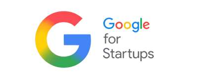</a>
    &nbsp;&nbsp;
    <a href="https://aws.amazon.com/startups" target="_blank">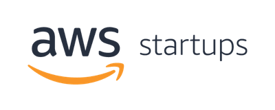</a>
  

  
<small><a href="https://flikta.com">Flikta</a> is part of the Google for Startups and AWS Startups programs.</small>

   
   

  <h3>— EDUCATION —</h3>
   
  
  

    <b>Information Systems</b> (Sistemas de Informação) 
    Universidade Federal de Santa Maria — UFSM
  

   
   

  <h3>— CHECKOUT WHAT I'M BUILDING —</h3>
  
14 projects designed, built and shipped at <a href="https://www.zarpstudio.com"><b>Zarp Studio</b></a>

   
  <table>
    <tr>
      <td align="center" width="50%">
        <a href="https://www.zarpstudio.com/work/allbrick-pavers">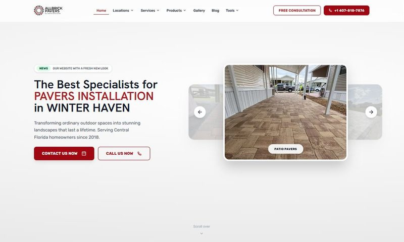</a>
         
        <b>ALLBRICK PAVERS</b> 
        <small>Pavers &amp; Hardscaping • 2026</small>
      </td>
      <td align="center" width="50%">
        <a href="https://www.zarpstudio.com/work/coastal-roofing-group">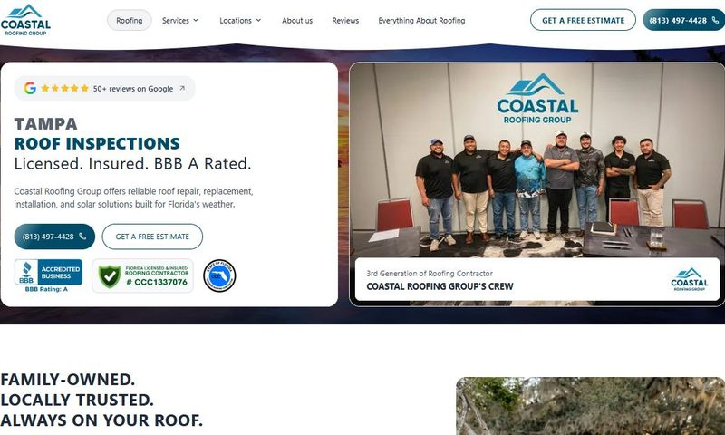</a>
         
        <b>COASTAL ROOFING GROUP</b> 
        <small>Roofing Contractor • 2026</small>
      </td>
    </tr>
    <tr>
      <td align="center" width="50%">
        <a href="https://www.zarpstudio.com/work/phenomenal-renovation">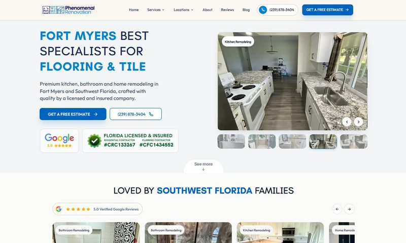</a>
         
        <b>PHENOMENAL RENOVATION</b> 
        <small>Kitchen &amp; Bath Remodeling • 2026</small>
      </td>
      <td align="center" width="50%">
        <a href="https://www.zarpstudio.com/work/jbs-southwest-florida">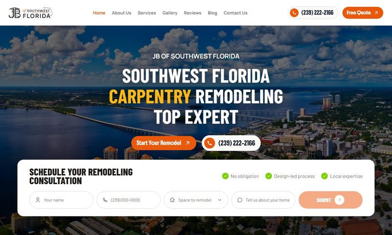</a>
         
        <b>JB OF SW FLORIDA</b> 
        <small>Interior Remodeling • 2026</small>
      </td>
    </tr>
    <tr>
      <td align="center" width="50%">
        <a href="https://www.zarpstudio.com/work/master-cabinets">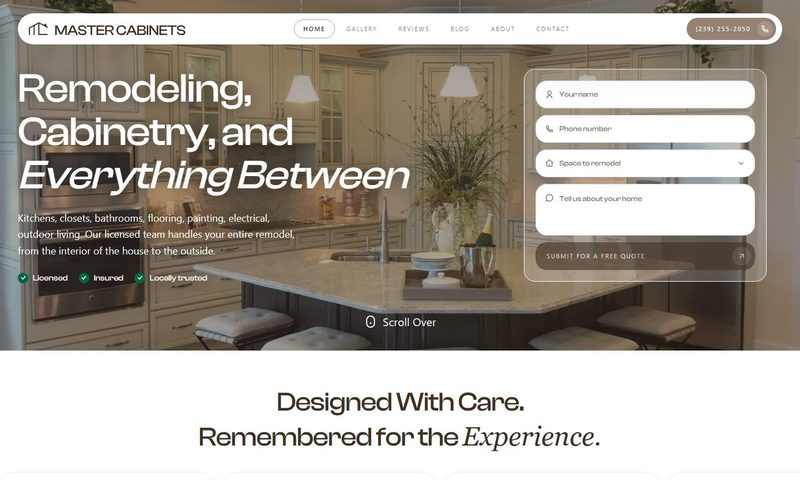</a>
         
        <b>MASTER CABINETS</b> 
        <small>Custom Cabinetry &amp; Remodeling • 2026</small>
      </td>
      <td align="center" width="50%">
        <a href="https://www.zarpstudio.com/work/level-one-grading">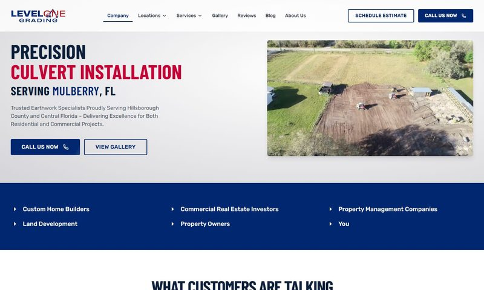</a>
         
        <b>LEVEL ONE GRADING</b> 
        <small>Excavation &amp; Land Grading • 2026</small>
      </td>
    </tr>
    <tr>
      <td align="center" width="50%">
        <a href="https://www.zarpstudio.com/work/kays-cleaning-service">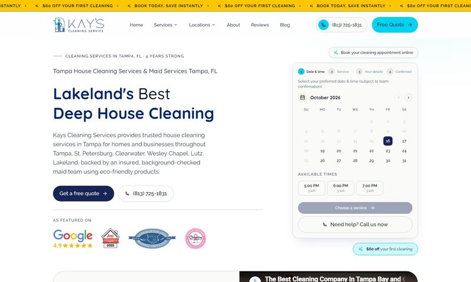</a>
         
        <b>KAY'S CLEANING SERVICE</b> 
        <small>House Cleaning &amp; Maid Service • 2026</small>
      </td>
      <td align="center" width="50%">
        <a href="https://www.zarpstudio.com/work/licensefix-school">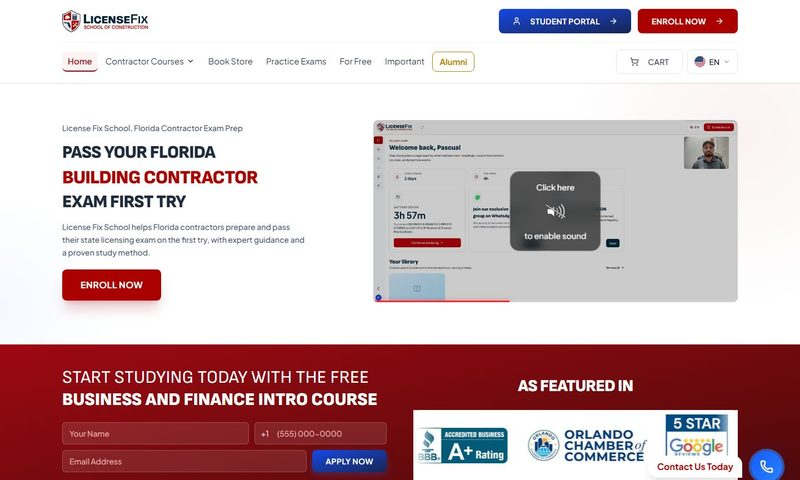</a>
         
        <b>LICENSEFIX SCHOOL OF CONSTRUCTION</b> 
        <small>Contractor Exam Prep &amp; Online Courses • 2026</small>
      </td>
    </tr>
    <tr>
      <td align="center" width="50%">
        <a href="https://www.zarpstudio.com/work/latibras-insurance">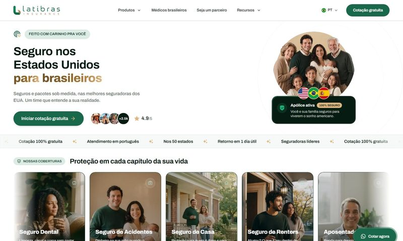</a>
         
        <b>LATIBRAS INSURANCE</b> 
        <small>Insurance Agency • 2026</small>
      </td>
      <td align="center" width="50%">
        <a href="https://www.zarpstudio.com/work/a1-magic-bail-bonds">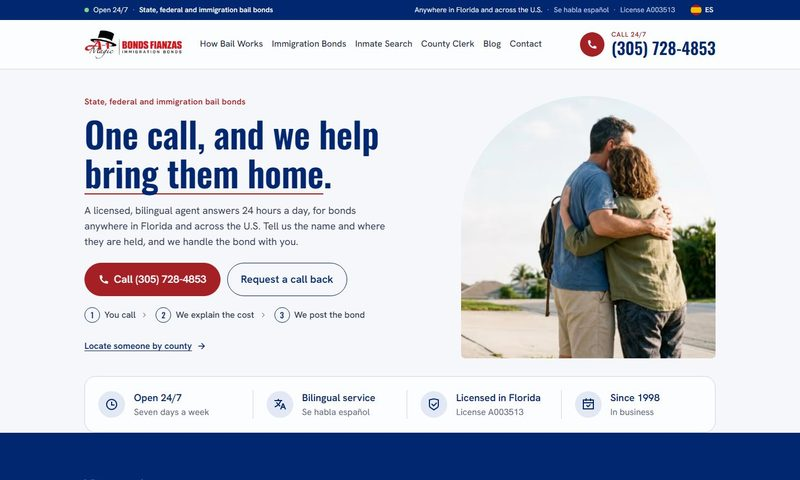</a>
         
        <b>A1 MAGIC BAIL BONDS</b> 
        <small>Bail Bonds • 2026</small>
      </td>
    </tr>
    <tr>
      <td align="center" width="50%">
        <a href="https://www.zarpstudio.com/work/atw-lie-detector">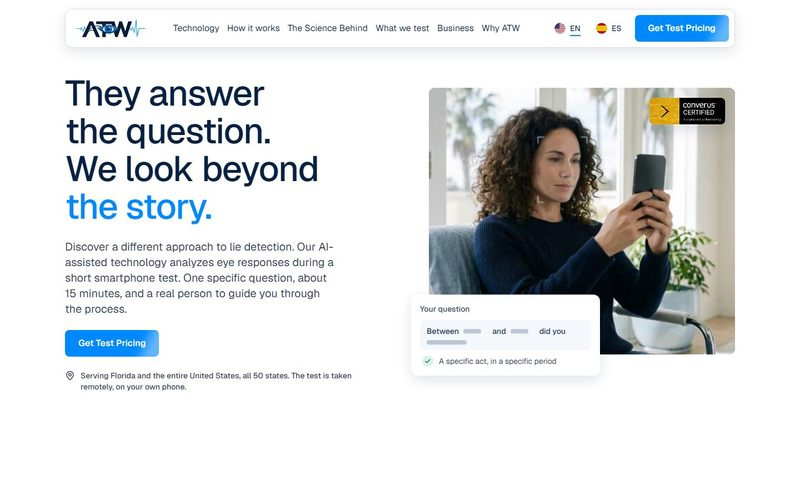</a>
         
        <b>ATW LIE DETECTOR</b> 
        <small>Lie Detection Testing • 2026</small>
      </td>
      <td align="center" width="50%">
        <a href="https://www.zarpstudio.com/work/orlando-identity-testing">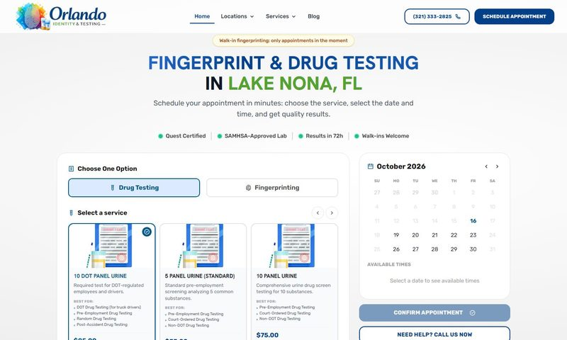</a>
         
        <b>ORLANDO IDENTITY &amp; TESTING</b> 
        <small>Fingerprinting &amp; Drug Testing • 2026</small>
      </td>
    </tr>
    <tr>
      <td align="center" width="50%">
        
         
        <b>FLIKTA</b> 
        <small>SaaS • 2024</small>
      </td>
      <td align="center" width="50%">
        <a href="https://www.zarpstudio.com/work/steez-drink">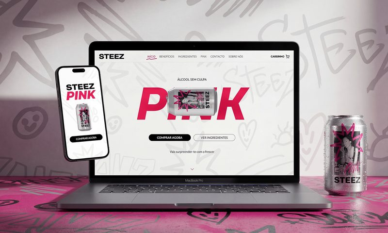</a>
         
        <b>STEEZ DRINK</b> 
        <small>E-Commerce • 2023</small>
      </td>
    </tr>
  </table>
   
  <a href="https://www.zarpstudio.com/work"><b>EXPLORE ALL PROJECTS AT ZARPSTUDIO.COM →</b></a>

   
   
   

  <h3>— THE WEB STACK —</h3>
   

  

|   **CATEGORY**   | **TECHNOLOGIES**                                                                                                                                                                                                                                                                                                                                                                                                                                                                                                                                                                                                                                             |
| :--------------: | :----------------------------------------------------------------------------------------------------------------------------------------------------------------------------------------------------------------------------------------------------------------------------------------------------------------------------------------------------------------------------------------------------------------------------------------------------------------------------------------------------------------------------------------------------------------------------------------------------------------------------------------------------------- |
|   **FRONTEND**   |                                                                                                                                                                                                                   |
|   **BACKEND**    |                                                                                                                    |
| **OPS / DESIGN** |       |

  

   
   
   

  <h3>— GITHUB STATS —</h3>
   
  
  <table>
    <tr>
      <td align="center" width="50%">
        
      </td>
      <td align="center" width="50%">
        
      </td>
    </tr>
  </table>

